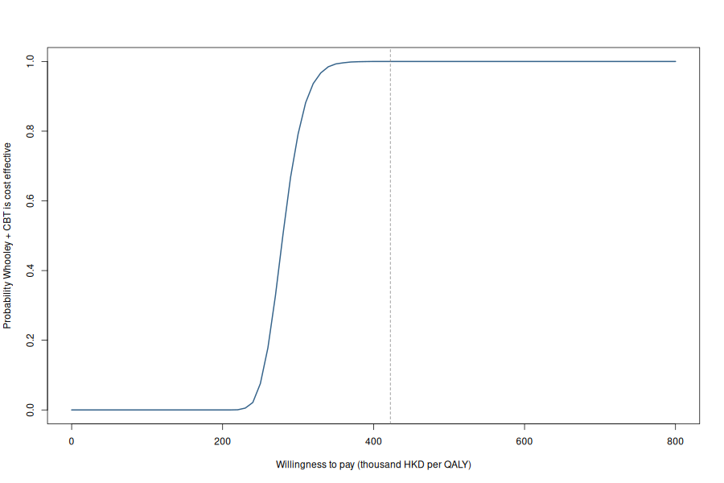

# Postpartum depression screening models in R

Three implementations of the screening decision problem in [Wang et al. (2025)](https://doi.org/10.1186/s12888-025-07459-y): EPDS with usual care versus Whooley screening followed by CBT in Hong Kong. This is a modeling exercise using published inputs, not a reproduction of the authors' TreeAge model.

## Run

From the repository root with R 4.3 or later:

```bash
Rscript scripts/01_decision_tree.R
Rscript scripts/02_cohort_markov.R
Rscript scripts/03_microsimulation.R
Rscript tests/check_outputs.R
```

All scripts use base R. The seed, nine-month horizon, willingness-to-pay value, Table 1 inputs, and treatment costs are in [`R/model.R`](R/model.R). Results are written to `results/`, which Git ignores. No external data file is needed.

## Model choices

| Script | Purpose | Main assumption |
| --- | --- | --- |
| Decision tree | Four screening branches and 10,000-draw parameter sensitivity analysis | The final health state applies throughout the nine-month horizon. |
| Cohort Markov | Monthly state occupancy and accumulated QALYs | A constant monthly remission probability reproduces the published endpoint treatment response. |
| Patient simulation | Individual pathways and paired Monte Carlo comparison with the tree | Both strategies use the same simulated patients and random draws. |

The decision tree and patient simulation calculate nine-month QALYs as final-state utility × 9/12. The Markov model instead accrues utility during each monthly cycle, with a half-cycle correction. For the Markov transition, the probability of no improvement after nine months, `p`, implies monthly remission probability `1 - p^(1/9)`. This is a timing scenario: the paper reports endpoint response, not monthly remission. Patients still depressed at the end of treatment move from the treated to the untreated state. As in the published base-case structure, no new depression, spontaneous remission, or relapse is modeled.

The PSA varies prevalence, test accuracy, treatment response, and utilities using Beta distributions derived from the reported means and standard deviations. Unit costs stay fixed. Patient simulation varies individual outcomes at fixed base-case inputs; its Monte Carlo intervals are simulation error, not parameter uncertainty.

| Base-case result | Decision tree | Markov |
| --- | ---: | ---: |
| TAU cost (HKD) | 2,312.97 | 2,312.97 |
| Whooley + CBT cost (HKD) | 5,834.76 | 5,834.76 |
| Incremental QALYs | 0.012577 | 0.008030 |
| ICER (HKD/QALY) | 280,020 | 438,581 |

The paper reports costs of HKD 2,242.14 and 5,435.29. The explicit resource bundles here yield different costs; the numerical results above belong to this implementation. The difference between the two R models' QALYs comes from when remission occurs, not from different screening branches or treatment costs.



**Source:** Wang B, Shen S, Lok KYW, Lin J, Smith RD. Cost-utility analysis of screening and cognitive behavioral therapy compared to usual care for postpartum depression. *BMC Psychiatry*. 2025;25:1017. [doi:10.1186/s12888-025-07459-y](https://doi.org/10.1186/s12888-025-07459-y).
